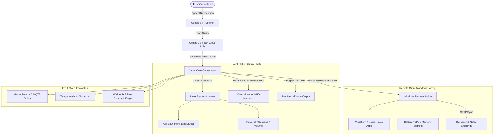

# ⚡ JARVIS: Dual-Device AI Desktop Assistant & Cybernetic HUD

<div align="center">

[](https://opensource.org/licenses/MIT)
[](https://www.python.org/downloads/)
[](https://ai.google.dev/)
[](#)
[](#)

### *"Good morning, sir. All systems are fully operational across your workstation."*

**Transform your multi-device workspace into Tony Stark’s legendary Stark Industries lab.**  
*Seamlessly command your Linux Workstation and Windows Laptop with hands-free voice intelligence, cross-device SSH telemetry, and an ultra-futuristic 3D Arc-Reactor HUD.*

[🚀 Quick Start](#-quick-start) • [✨ Features](#-key-features) • [🧠 Architecture](#-system-architecture) • [🎙️ Voice Commands](#%EF%B8%8F-voice-commands-cheat-sheet) • [🛡️ Security](#%EF%B8%8F-security--environment-setup)

</div>

---

## 🔥 Why JARVIS?

Tired of context-switching between different operating systems, typing routine terminal commands, and managing separate machines? **JARVIS** bridges the gap between your physical devices into a single, cohesive neural command center.

* 🗣️ **Deep British Neural Voice**: Powered by Microsoft Edge-TTS (`en-GB-RyanNeural` modulated at -12Hz) for the authentic, calm, authoritative JARVIS experience.
* 🌐 **Dual-Device Cross-Bridge**: Control your Linux host and Windows laptop concurrently over encrypted SSH/SFTP.
* ⚡ **Gemini 3.8 Flash Reasoning**: Near-instant natural language intent parsing, screen reasoning, and autonomous deep research dossiers.
* 🎛️ **Cinematic 3D Arc-Reactor HUD**: Live animated Three.js / WebGL holographic ring interface reacting to voice waveforms and system telemetry.
* ❄️ **Smart Home Integration**: Native MirAIe protocol control for smart ACs, room climate, and ambient scene switching.

---

## 🧠 System Architecture



---

## ✨ Key Features

### 1. Dual-Device Orchestration
- Seamlessly trigger actions on your primary Linux PC or companion Windows laptop without leaving your desk.
- Launch applications (Flatpak, Snap, Native `.desktop` entries, Windows EXEs).
- Media playback controls across devices (Volume up/down, Next track, Play/Pause).
- Coordinated power management: Put both rigs to sleep or initiate a synchronized shutdown with a single voice command.

### 2. Intelligent Voice & Vision
- **Hands-Free Wake Listener**: Instant wake-word activation and robust ambient noise suppression.
- **Multimodal Screen Reasoning**: Captures multi-monitor screen snapshots, analyzes complex code snippets, math problems, or terminal errors, and speaks the solution back to you.
- **Deep Research Engine**: Generates comprehensive PDF research dossiers on any topic and syncs them directly to your laptop via SFTP.

### 3. Stark Industries 3D Arc-Reactor HUD
- Built with Three.js / WebGL with particle physics, orbital trajectory rings, and glowing neon telemetry.
- Real-time CPU, RAM, battery percentage, network ping, and active task visualization.
- Audio visualizer rings sync rhythmically with JARVIS's speech output.

### 4. Productivity, Smart Home & Automation
- **Study & Focus Lock**: Snaps designated research windows, silences distracting processes, and tracks study hours.
- **MirAIe Smart Home Integration**: Voice-controlled AC temperature, power, and climate profiles.
- **Autonomous Daily Briefing**: Weather conditions, top news summaries, daily calendar goals, and system diagnostics upon startup.

---

## 🚀 Quick Start

### Prerequisites
- **Host OS**: Linux (Ubuntu, Debian, Fedora, Arch)
- **Client OS (Optional for Remote Control)**: Windows 10/11 with OpenSSH Server enabled
- **Python**: 3.10 or higher
- **Microphone & Speakers**

### 1. Clone the Repository
```bash
git clone https://github.com/vedantojha2612-cyber/jarvis.git
cd jarvis
```

### 2. Create Virtual Environment & Install Dependencies
```bash
python3 -m venv venv
source venv/bin/activate
pip install -r requirements.txt
```

### 3. Configure Environment Variables
Copy the example environment template and fill in your credentials:
```bash
cp .env.example .env
nano .env
```

### 4. Ignite JARVIS
```bash
chmod +x start_jarvis.sh
./start_jarvis.sh
```
*JARVIS will initialize its subsystems, launch the Arc-Reactor HUD, and report ready for commands.*

---

## 🎙️ Voice Commands Cheat Sheet

| Voice Command | Action |
| :--- | :--- |
| **"Jarvis, run system diagnostics"** | Audits CPU, RAM, battery on both machines and delivers verbal health report |
| **"Jarvis, open YouTube on laptop"** | Dispatches remote SSH payload to launch browser and search query on Windows |
| **"Jarvis, prepare study mode"** | Snaps study windows, turns down AC to 23°C, sets focus playlist |
| **"Jarvis, solve this problem on screen"** | Captures active display, invokes Gemini 3.8 Flash Vision, explains solution |
| **"Jarvis, research quantum computing"** | Generates deep technical briefing dossier and saves PDF report |
| **"Jarvis, sleep all systems"** | Gracefully puts both Linux desktop and Windows laptop into low-power sleep |

---

## 🛡️ Security & Environment Setup

All sensitive credentials and network secrets are isolated in `.env` and kept strictly out of version control.

### Example `.env` Configuration
```ini
# Google Gemini AI Cloud Brain
GEMINI_API_KEY="your_gemini_api_key_here"

# Windows Companion Device (SSH Remote Bridge)
LAPTOP_IP="192.168.1.6"
LAPTOP_USER="jarvis"
LAPTOP_PASSWORD="your_secure_ssh_password"
MAIN_WINDOWS_USER="your_windows_username"

# Smart Home & IoT (Optional)
MIRAIE_USER="your_miraie_username"
MIRAIE_PASSWORD="your_miraie_password"
TELEGRAM_BOT_TOKEN="your_telegram_bot_token"
TELEGRAM_CHAT_ID="your_telegram_chat_id"

# Audio & Server Tuning
EDGE_TTS_VOICE="en-GB-RyanNeural"
EDGE_TTS_PITCH="-12Hz"
HUD_PORT=5000
```

> **Important**: Never commit your `.env` file or hardcode credentials into source files. Ensure `.gitignore` is properly configured before pushing commits.

---

## 📁 Repository Structure

```
├── .env.example            # Environment variables template
├── .gitignore              # Production-ready git ignore rules
├── README.md               # Project documentation & quick start guide
├── requirements.txt        # Python dependency manifest
├── start_jarvis.sh         # One-click startup shell script
├── jarvis_v2.py            # Primary core orchestration engine (Flask + Gemini + Voice)
├── template.html           # 3D Arc-Reactor WebGL HUD interface
└── screenshots/            # Visual previews and UI screenshots
```

---

## 🤝 Contributing

Contributions are what make the open-source community an inspiring place to learn, create, and build. Any contributions you make are **greatly appreciated**.

1. Fork the Project
2. Create your Feature Branch (`git checkout -b feature/FuturisticUpgrade`)
3. Commit your Changes (`git commit -m 'Add holographic audio wave visualizer'`)
4. Push to the Branch (`git push origin feature/FuturisticUpgrade`)
5. Open a Pull Request

---

## 📜 License

Distributed under the MIT License. See `LICENSE` for more information.

<div align="center">
<sub>Designed with ⚡ by SAARTHAK OJHA • Powered by OpenMausBot & Gemini</sub>
</div>
